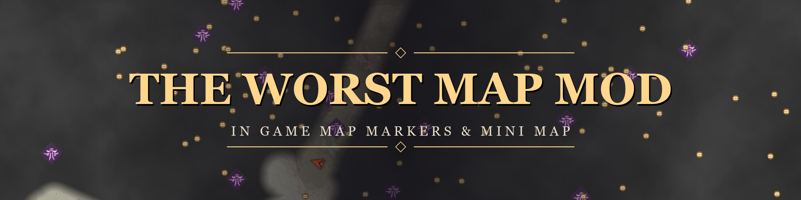
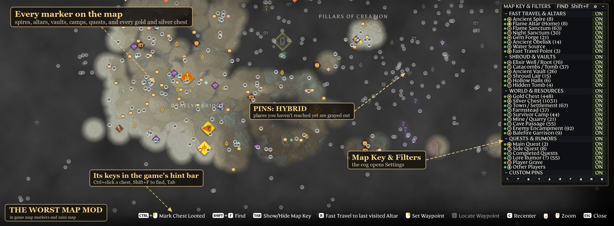
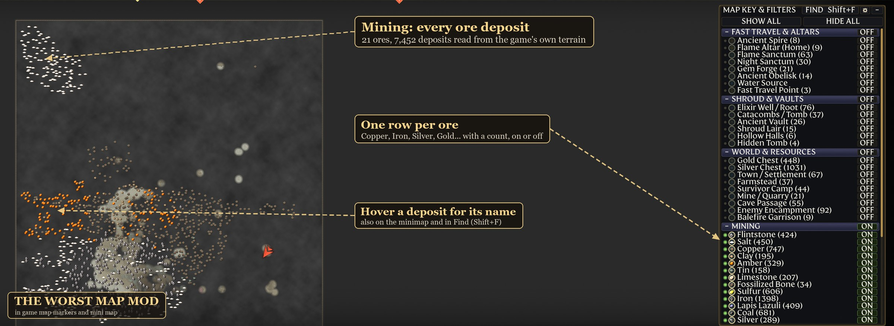
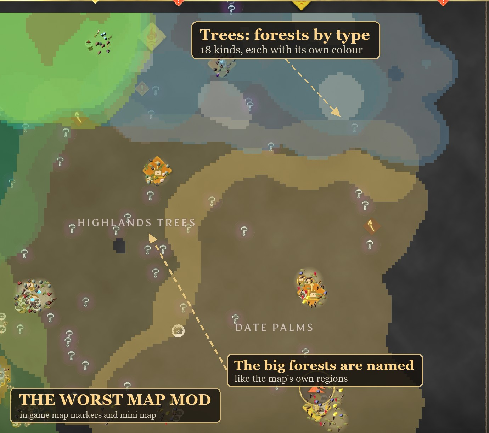
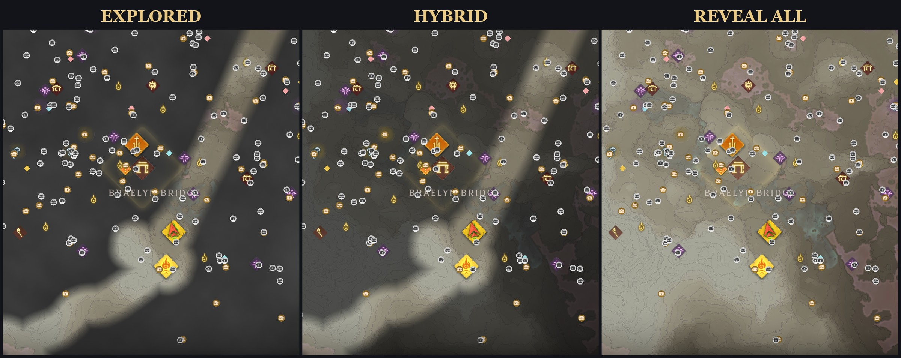
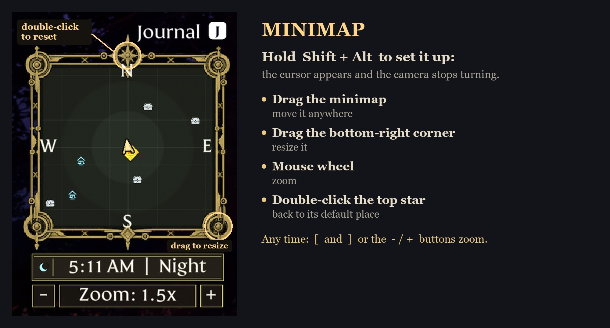

# In Game Map Markers and Mini Map — The Worst Map Mod (Enshrouded)













- **Every marker on the world map**: spires, altars, sanctums, vaults, lairs, towns, camps, mines, caves, garrisons, quests, lore rumors, graves, and all 448 gold and 1032 silver chests.
- **Mining, Materials, Plants, Bait and Trees**: every ore deposit (21 kinds), material, plant patch and bait spot, read from the game's own world files, on the world map, the minimap and in Find; every forest drawn as a shape in its tree type's colour.
- **Map Key & Filters panel** drawn with the game's own UI pieces: icon, count and ON/OFF per marker type, whole categories, custom pin filters, completed quests, SHOW ALL / HIDE ALL. It scrolls; Tab folds it away.
- **Two more zoom steps out** on the world map.
- **Find on the map** (Shift+F): type a name or a kind of place and the map moves to show the matches.
- **Settings** (the cog): fog modes (EXPLORED, HYBRID, REVEAL ALL), pin modes (pins only where you've been, grayed in unexplored land, or all), custom marker size and minimap options.
- **Looted chests**: opening a chest marks it (hidden or grayed with a check mark); chests come back after 30 minutes of play outside build zones. Saved per world, and shared with other players who have the mod.
- **HUD minimap** with the World Map's terrain, a compass, the time of day or the weather, and other players as colored arrows: hold Shift + Alt to drag it, resize it from the bottom-right corner and zoom with the wheel. `[` and `]` zoom any time.
- **All 15 game languages**: the mod's text follows the game's language (or `Language=` in `minimap_config.ini`). Translations are my own; corrections welcome.
- Client only. Works in single player, hosted games and on any server, with nothing installed on the server.

Download and install instructions: [Nexus Mods page](https://www.nexusmods.com/enshrouded/mods/220). The player-facing readme is [dist/README.txt](dist/README.txt).

## Building

Needs Visual Studio 2022 Build Tools (x64).

```
build.bat   -> bin\loader\unlock-map-markers.dll and mod.json, then runs tests\test_patches.cpp
               (checks every byte patch site against the installed game and server executables)
deploy.py   -> installs the build into the game's greeneye\unlock-map-markers\ (game closed)
```

The mod runs through the Greeneye Loader (API 2, `src/greeneye.h`). All hooks go through the loader, which chains onto other mods' hooks instead of overwriting them (`src/jumppatch.h`). Every detour holds a `greeneye::Lease`, so the mod can be hot reloaded while idle. Code sites are found by unique signature. A site that doesn't match is skipped and logged instead of patched.

- `src/main.cpp`: start-up, byte patches (`src/patches.h`) that send every marker to the map UI.
- `src/map_key_panel.cpp`: the panel, Find, fog modes and the minimap.
- `src/lang.cpp`: the mod's text in every language, language detection (Steam's game language) and text widths.
- `src/chest_spawns.h`: chest spawn table.
- `src/minimap_art.h`: the minimap frame, tray, N medallion and weather icons as solid rects, generated from
  the vector art in `art/` by `art/gen_minimap_art.py` (needs Microsoft Edge to render the SVG).

## License

MIT, see [LICENSE](LICENSE). Made with the help of AI (Claude by Anthropic, OpenAI Codex and Google Antigravity).
